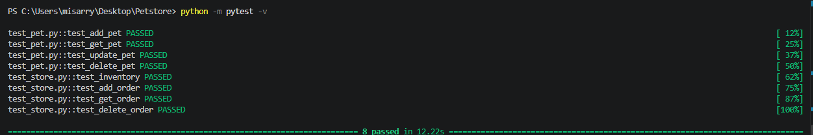

# Результаты тестирования

Результаты перенесены с сохранённого скриншота запуска pytest.

Команда запуска:

```text
python -m pytest -v
```

```text
test_pet.py::test_add_pet PASSED                 [ 12%]
test_pet.py::test_get_pet PASSED                 [ 25%]
test_pet.py::test_update_pet PASSED              [ 37%]
test_pet.py::test_delete_pet PASSED              [ 50%]
test_store.py::test_inventory PASSED            [ 62%]
test_store.py::test_add_order PASSED            [ 75%]
test_store.py::test_get_order PASSED            [ 87%]
test_store.py::test_delete_order PASSED         [100%]

====================== 8 passed in 12.22s ======================
```

Всего прошло 8 тестов. Время выполнения — 12,22 секунды.

Скриншот запуска

 , (test_results_2.png)
